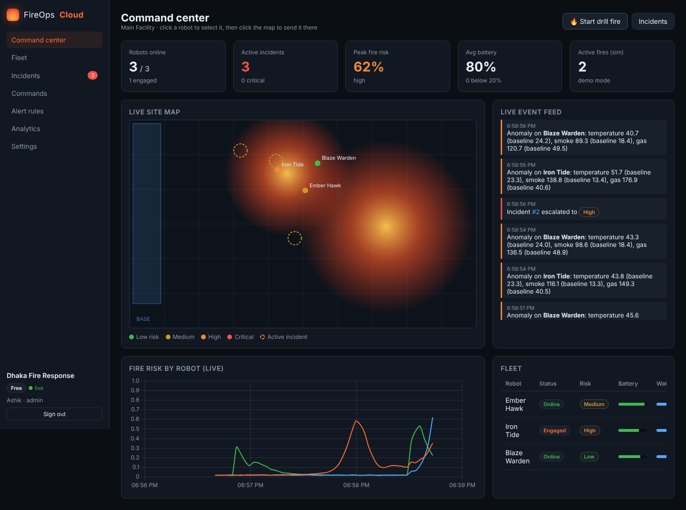

# FireOps Cloud

A multi-tenant SaaS command center for fleets of fire-fighting robots. Robots stream sensor
telemetry; FireOps scores fire risk in real time, opens and escalates incidents automatically,
lets operators dispatch the nearest robots, and predicts maintenance needs, all from one live dashboard.



## Features

| Area | What you get |
|---|---|
| **Multi-tenancy** | Organisations with isolated data, JWT auth, and `admin` / `operator` / `viewer` roles |
| **Device API** | A hashed, rotatable API key per robot, single or batch telemetry ingest (offline buffering), and command polling with acknowledgements |
| **Fire-risk engine** | A logistic risk model over temperature, smoke, gas, humidity and flame, with per-feature explanations ("why this score") |
| **Anomaly detection** | A robust (median/MAD) z-score against each robot's own baseline, which catches sensor spikes before they become fires |
| **Incident management** | Incidents are auto-opened, de-duplicated and escalated. Each has a lifecycle (open → acknowledged → resolved), assignees, notes and a full timeline |
| **Dispatch** | One click ranks robots by distance, battery and water, then queues `move_to` and `suppress` for each one it picks |
| **Alert rules** | Custom per-org threshold rules on any metric, evaluated on every sample |
| **Predictive maintenance** | Battery drain rate and time to reserve, a motor-temperature trend and overheat ETA, tank level, a health score and recommendations |
| **Analytics** | MTTA / MTTR / p90, a fleet risk trend, a spatial risk heatmap, a what-if risk predictor and CSV export |
| **Realtime** | A WebSocket stream drives the live map, charts, event feed and toasts |
| **Integrations** | HMAC-signed outbound webhooks (`X-FireOps-Signature: sha256=…`) with test delivery |
| **SaaS plumbing** | Free / Pro / Enterprise plans with robot, user and telemetry quotas, usage metering, an audit log and a demo mode |
| **Simulator** | A built-in physics-lite fleet simulator (patrols, battery drain, spreading fires, command execution) that runs through the same pipeline as real hardware |

## Quick start

```bash
cd saas
pip install -r requirements.txt
FIREOPS_SECRET=change-me uvicorn fireops.main:app --reload
```

Open http://localhost:8000, create an organisation, and click **Launch simulated demo fleet**.
Use **Start drill fire** and watch the robots detect it, incidents open, and dispatch them.
Interactive API docs are at http://localhost:8000/docs.

With Docker:

```bash
docker build -t fireops saas && docker run -p 8000:8000 -e FIREOPS_SECRET=change-me -v fireops:/data fireops
```

## Connecting a real robot

Register the robot in **Fleet → Register robot** and copy its device key (it is shown once). Then run on the robot:

```bash
FIREOPS_URL=https://your-host FIREOPS_DEVICE_KEY=fod_... python robot_client.py
```

`robot_client.py` uses only the standard library. Replace `read_sensors()` / `execute()` with calls into
`automation/sensor_manager.py` and `automation/robot_controller.py`.

Device endpoints (header `X-Device-Key`):

| Method | Path | Purpose |
|---|---|---|
| POST | `/api/device/telemetry` | One sample: `temperature, smoke, gas, humidity, flame, battery, water_level, motor_temp, x, y` |
| POST | `/api/device/telemetry/batch` | Up to 500 timestamped samples (replay after connectivity loss) |
| GET | `/api/device/commands` | Fetch queued commands (marks them delivered) |
| POST | `/api/device/commands/{id}/ack` | Report `in_progress` / `completed` / `failed` with an optional result |

Command kinds: `move_to {x, y}`, `suppress`, `return_to_base`, `patrol`, `halt`, `scan`.

## Configuration

| Variable | Default | Meaning |
|---|---|---|
| `FIREOPS_SECRET` | random per process | JWT signing secret. **Set it in production** |
| `FIREOPS_DB` | `fireops.db` | SQLite database path (WAL mode) |
| `FIREOPS_JWT_TTL` | `720` | Token lifetime in minutes |
| `FIREOPS_SIMULATOR` | `1` | Run the simulator worker (it only drives orgs that enable demo mode) |
| `FIREOPS_SIM_INTERVAL` | `2.0` | Simulator tick in seconds |

## Architecture

```
fireops/
  main.py          app wiring, WebSocket endpoint, demo endpoints, static SPA
  routers/auth.py  signup/login/me, team management
  routers/fleet.py sites, robots, telemetry queries, CSV export, commands, device API
  routers/ops.py   incidents, dispatch, alert rules, analytics, webhooks, billing, audit
  services.py      ingest pipeline: quota → risk → store → rules/anomaly → incidents → events
  analytics.py     risk model, explanations, anomaly detection, maintenance forecasting
  simulator.py     demo-mode fleet + fire simulation
  realtime.py      per-org WebSocket hub (thread-safe publish)
  notifier.py      background HMAC-signed webhook delivery
  static/          dashboard SPA (vanilla JS + Chart.js, no build step)
```

Billing is a plan switch in this version. Connect `/api/billing/plan` to a payment provider's
checkout/webhook before charging customers.

## Tests

```bash
cd saas && pytest -q
```
